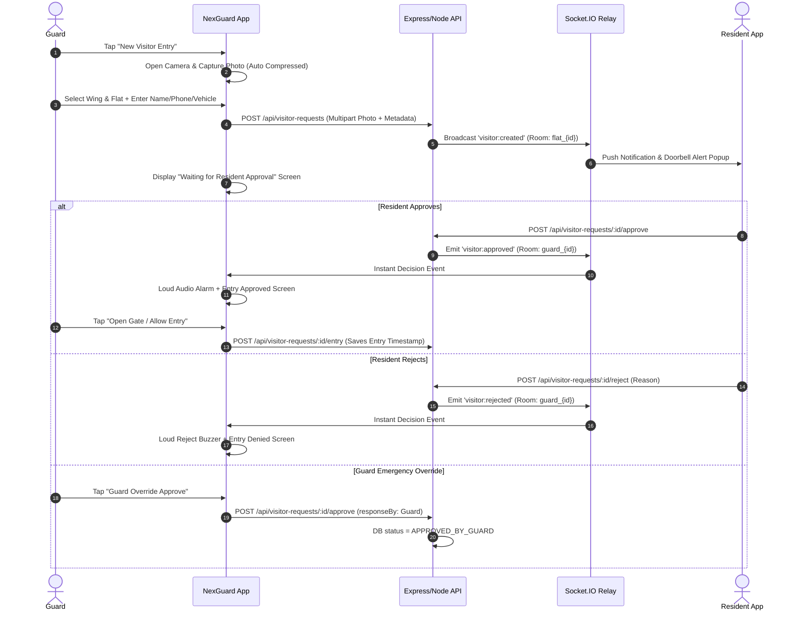
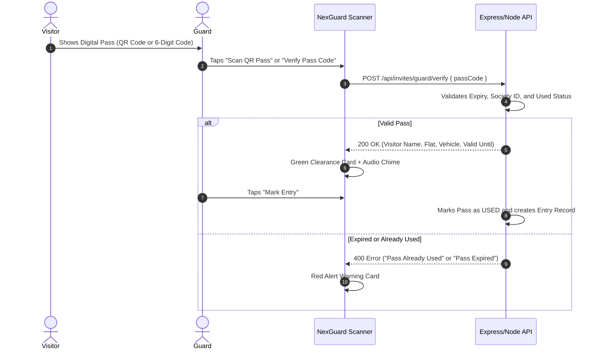

# NexGuard — System & UI/UX Architecture Design Document

**Product:** NexGuard (Security Gate Terminal Application)  
**Version:** 1.0.4  
**Target Platform:** Android (Tablets & Smartphones in Dedicated Kiosk Mode)  
**Primary Users:** Society Security Guards, Gate Supervisors, Head of Security  

---

## 1. Executive Summary & Product Vision

**NexGuard** is an industrial-grade, mission-critical gate terminal application engineered for residential communities and commercial complexes. It bridges the physical society gate with the digital community ecosystem, coordinating real-time visitor authorization between security personnel, residents, and administrative management.

### Key Goals:
1. **Zero-Latency Gate Clearance:** Average visitor entry processing time under 15 seconds.
2. **50+ User Persona Accessibility:** High-contrast color hierarchy, large touch targets (minimum 48–56px), and bilingual accessibility (English & Hindi) designed specifically for security guards.
3. **Resilient Offline-First & Real-Time Sync:** Operates seamlessly during network drops, with immediate bidirectional Socket.IO synchronization upon reconnection.
4. **Hardened Kiosk Lockdown:** Built to run continuously in single-app or multi-app enterprise kiosk environments (e.g., SureLock, Android Lock Task Mode).

---

## 2. User Persona & Ergonomic Considerations

| Attribute | Guard Terminal Persona | Design Accommodation |
| :--- | :--- | :--- |
| **Age Group** | 40 to 60+ years | Extra bold typography, 15px+ body text, 22px+ status headers |
| **Environment** | Outdoor gate cabin, bright sunlight, night shifts | High-contrast backgrounds (`#F5F7FB`), saturated primary color (`#3A3FB5`), explicit borders (`#E4E8F0`) |
| **Motor Skills** | Gloves, rapid thumb/finger inputs | Buttons with minimum 52px height, full-width action strips, generous padding |
| **Language** | Vernacular / Hindi primary, English secondary | 100% reactive bilingual string catalog powered by `LanguageService` |
| **Cognitive Load** | High stress during rush hours (deliveries, cabs) | Visual badge color-coding: Green = Enter, Red = Deny, Amber = Waiting |

---

## 3. Design System & Visual Foundation

### 3.1 Color Palette

```
Primary Indigo:      #3A3FB5  (Brand, Primary Action, Active Navigation)
Primary Dark:        #2B2F8F  (Hero Headers, Modal Title Accents)
Primary Light:       #EEF0FF  (Selected Chip Background, Card Tints)

Success / Approved:  #16A34A  (Gate Entry Allowed, Verified Badges)
Success Background:  #EAF8F0  (Approved Status Container)
Success Border:      #BFE8D0  (Approved Card Outline)

Error / Rejected:    #DC2626  (Entry Denied, Critical Alerts)
Error Background:    #FDEEEE  (Rejected Status Container)
Error Border:        #F5C6C6  (Rejected Card Outline)

Warning / Pending:   #D97706  (Waiting for Resident Approval)
Warning Background:  #FFF6E0  (Pending Status Container)
Warning Border:      #F6DFA6  (Pending Card Outline)

Neutral Surfaces:
- Canvas / Screen:   #F5F7FB  (Comfortable soft grey-blue)
- Card Containers:   #FFFFFF  (Pure white with crisp 1px borders)
- Subtle Field Fill: #F2F4F8  (Input backgrounds)
- Text Primary:      #101828  (Deep Charcoal / Almost Black)
- Text Secondary:    #334155  (Slate)
- Text Muted:        #64748B  (Helper Text & Placeholders)
```

### 3.2 Typography Standards
* **Font Family:** `Inter` (San-Serif, high x-height for maximum LCD/OLED clarity).
* **Hierarchy:**
  * **Hero Header / Screen Title:** 20px–22px, `FontWeight.w800`, Letter Spacing: `-0.5px`
  * **Section Header:** 16px–18px, `FontWeight.w700`
  * **Card Primary Text (Visitor Name):** 16px, `FontWeight.w700`, Color: `#101828`
  * **Card Secondary Text (Flat / Purpose):** 13px–14px, `FontWeight.w500`, Color: `#334155`
  * **Timestamp & Metadata:** 12px, `FontWeight.w500`, Color: `#64748B`
  * **PIN / Passcode Displays:** 22px–28px, `FontWeight.w800`, Letter Spacing: `4.0px–6.0px`

### 3.3 Component Elevation & Shape
* **Card Corner Radius:** 16px (`BorderRadius.circular(16)`)
* **Action Buttons:** 12px–14px rounded corners, elevation 0 to 2 for flat modern tactile clarity.
* **Input Fields:** 14px border radius, 1.2px outline border, soft background fill (`#F2F4F8`).

---

## 4. Information Architecture & Navigation

The app is built upon a persistent, bottom-anchored 4-tab navigation shell (`MainNavigation`):

```
                        ┌──────────────────────────────┐
                        │      NexGuard Terminal       │
                        └──────────────┬───────────────┘
                                       │
        ┌──────────────────┬───────────┴──────────┬──────────────────┐
        │                  │                      │                  │
┌───────▼────────┐ ┌───────▼────────┐     ┌───────▼────────┐ ┌───────▼────────┐
│   Dashboard    │ │    Visitors    │     │    History     │ │    Profile     │
│  (Active Gate) │ │ (Live Approvals│     │  (Shift Logs   │ │  (Terminal &   │
│                │ │  & In-Progress)│     │  & Pagination) │ │   PIN Sync)    │
└────────────────┘ └────────────────┘     └────────────────┘ └────────────────┘
```

### 4.1 Tab Details:
1. **Dashboard Tab (`DashboardScreen`):**
   * Guard Profile Header (Guard Name, Gate Designation, Active Duty Badge).
   * Shift Overview Tiles: Pending Requests, Total Entries Today, Pre-Approved Passes.
   * Primary Action FAB/Cards: **"New Visitor Entry"** & **"Scan QR Pass"**.
   * Quick Verification Dialog for numeric 6-digit Pre-Approved Passcodes.
2. **Visitors Hub (`VisitorsScreen`):**
   * Real-time triage view of active visitors currently at the gate or inside society.
   * Instant action cards: "Allow Entry" (Mark Inside) and "Log Exit" (Mark Exited).
   * Filter chips: All, Pending, Approved, Inside Society.
3. **History Logs (`HistoryScreen`):**
   * Shift logs with **Infinite Scroll Pagination** (20 items per page).
   * Horizontal Date Selector Strip: **[ Today ]**, **[ Yesterday ]**, **[ All Dates ]**, **[ Calendar Picker ]**.
   * Status filter pills: Entered, Exited, Approved, Pending, Rejected.
   * Debounced Search bar (Visitor Name, Phone, Flat Number, Vehicle, Delivery Company).
4. **Terminal Profile (`ProfileScreen`):**
   * Shift summary and gate identifier.
   * **Language Selector:** One-tap toggle between English and Hindi.
   * **Security PIN Management:** Change 4-digit PIN dialog featuring **Current Active PIN Display** (prevents lockout if forgotten) and synchronized database hashing (`pin_hash` & `password_hash`).

---

## 5. End-to-End User Workflows

### 5.1 Workflow A: Walk-In Visitor Registration (Manual Gate Entry)



---

### 5.2 Workflow B: Pre-Approved Digital Pass Entry (Invites & Delivery QR)



---

## 6. Real-Time Architecture & Notification Pipeline

### 6.1 Socket.IO Real-Time Engine (`GuardSocketService`)
* **Connection Lifecycle:** Connects automatically upon guard login with JWT authentication; auto-reconnects on network loss.
* **Room Subscriptions:**
  * `guard:${guardId}`: Personalized alerts for requests raised at this specific terminal.
  * `guard_society:${societyId}`: Society-wide emergency and broadcast alerts.
* **Events Handled:**
  * `visitor:approved`: Triggers high-priority gate approval notification, audio chime, and updates UI status.
  * `visitor:rejected`: Triggers rejection banner, alert tone, and denial reasoning.
  * `visitor:request_updated`: Refreshes live queue state in `VisitorRepository`.

### 6.2 Loud Gate Alert & Audio Pipeline (`GuardNotificationService`)
Designed for noisy gate environments where guards might have their phone locked or in pocket:
* **Android Notification Channel:**
  * Channel ID: `nexguard_gate_alerts`
  * Importance: `Importance.max` (Heads-up banner over any active app)
  * Priority: `Priority.high`
* **Auditory & Haptic Feedback:**
  * `SystemSound.play(SystemSoundType.alert)`
  * Heavy impact vibration pattern: `[0, 500, 200, 500, 200, 800] ms`

---

## 7. Performance & Scalability Architecture

### 7.1 Backend-Driven Pagination & Date-Range SQL Indexing
* **Problem Solved:** Prevents memory exhaustion and network latency when societies accumulate tens of thousands of historical visitor logs.
* **Implementation:**
  * Queries use `LIMIT ? OFFSET ?` with dynamic page size of 20.
  * Multi-column SQL date filtering across `requested_at`, `entry_time`, and `exit_time`.
  * Total matching count returned via `countVisitorRequestsJoined` for precise UI counter badges.
* **Client-Side Infinite Scroll:**
  * `ScrollController` in `HistoryScreen` triggers background page fetches 250px before reaching the bottom.
  * Debounced search (350ms) prevents premature server queries while typing.

### 7.2 Image Optimization Pipeline (`ImageCompressService`)
* High-resolution camera photos captured at the gate are resized and compressed to JPEG quality (under 250 KB) before network transmission, reducing upload time on mobile networks by **~85%**.

---

## 8. Enterprise Kiosk & Hardware Lockdown Strategy

To prevent security guards from exiting the application or accessing unauthorized apps (e.g., YouTube, social media, games), NexGuard is architected for **Multi-App Kiosk Lockdown**:

### 8.1 The "Calling vs. Screen Pinning" Solution
* **Challenge:** When NexGuard initiates a phone call to a resident, Android's standard "Screen Pinning" displays an unpinning prompt (`"Hold back and overview to unpin"`), allowing guards to bypass restrictions.
* **Kiosk Solution (SureLock / MDM Allowlisting):**
  * Device configured in **Multi-App Kiosk Mode**.
  * **Allowed Packages:**
    1. `com.nexbuild.nexguard` (NexGuard Application)
    2. `com.android.contacts` / `com.google.android.dialer` (Native Phone Dialer)
    3. `com.android.incallui` (Active Call In-Progress Screen)
  * **Auto-Launch Hook:** NexGuard configured with `Auto Launch Delay = 0s`. As soon as a phone call terminates, the OS automatically returns focus to NexGuard.
  * **Hardware Lockdown:** Status bar pull-down, Home button, and Recent Apps buttons are suppressed by the Device Administrator.

---

## 9. Security & Data Integrity

1. **Authentication & PIN Storage:**
   * Guard authentication uses JWT tokens with 30-day validity for gate terminal continuity.
   * Guard 4-digit PIN is securely hashed using `bcrypt` (10 rounds) and mirrored across both `pin_hash` and `password_hash` in the central MySQL database.
2. **Multi-Tenant Isolation:**
   * Every database transaction and Socket.IO broadcast strictly enforces `society_id` scoping to prevent cross-society data leakage.
3. **Audit Trail:**
   * All gate decisions record timestamps for `requested_at`, `responded_at`, `entry_time`, and `exit_time`, along with the responding entity (`Security Guard`, `Resident`, or `Admin`).

---

## 10. File Structure & Module Mapping

```
nexguard/
├── lib/
│   ├── core/
│   │   ├── constants/       # AppColors, AppDimensions
│   │   ├── theme/           # AppTheme (Material 3, Inter font)
│   │   ├── utils/           # KioskHelper (Hardware & status bar hooks)
│   │   └── widgets/         # CustomButton, StatusBadge, VisitorPhotoAvatar
│   ├── features/
│   │   ├── auth/            # LoginScreen, SplashScreen
│   │   ├── dashboard/       # DashboardScreen, MainNavigation, QR Scanner
│   │   ├── history/         # HistoryScreen (Paginated logs, Date filtering)
│   │   ├── profile/         # ProfileScreen, Change PIN Dialog
│   │   ├── visitors/        # VisitorsScreen (Active gate queue)
│   │   └── visitor_entry/   # CameraCapture, VisitorDetails, WaitingApproval
│   ├── models/              # VisitorRequest, Visitor, Guard, Flat, Resident
│   ├── repositories/        # VisitorRepository, GuardRepository
│   ├── services/            # ApiService, GuardSocketService, GuardNotificationService,
│   │                        # LanguageService, StorageService, ImageCompressService
│   └── main.dart            # App entrypoint & service initialization
├── DESIGN.md                # System Design Document (This File)
└── pubspec.yaml             # Dependencies & assets manifest
```

---

*Authored by the Google Antigravity Engineering Team for the NexGuard Security Platform.*

